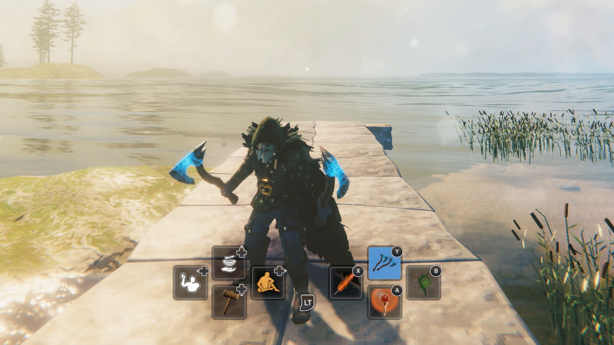
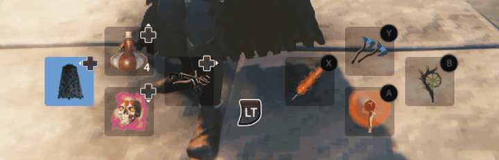
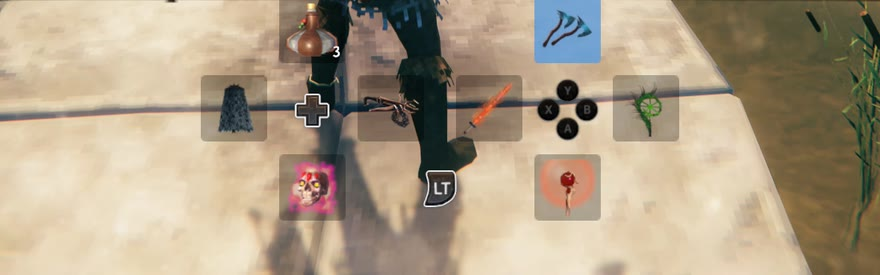
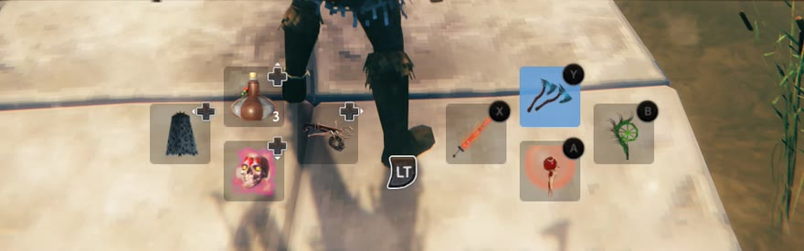
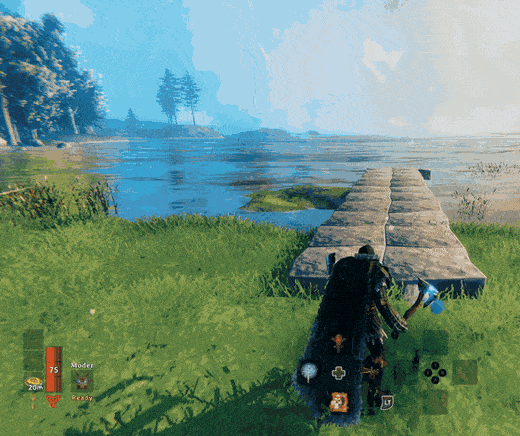
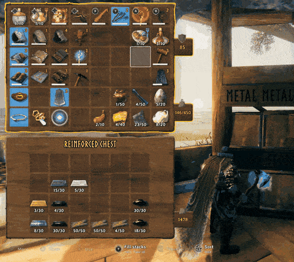
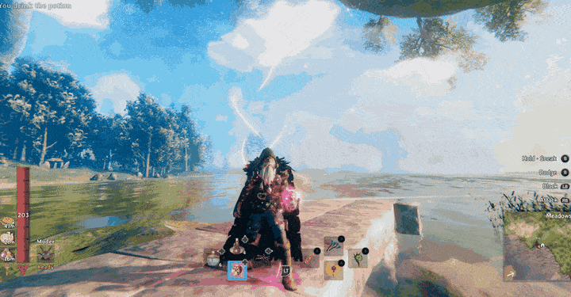

# 🎮 Controller Support Plus

**Valheim on a controller, the way it should have shipped.** No new mechanics, no flashy tools: just a controller that feels right at home, in Valheim's own look and feel.

✅ Client-side: works on any server, and nobody else needs it.

✅ Keyboard and mouse stay exactly as they are.

## 🚀 Getting started

- Install with a mod manager (r2modman or Thunderstore Mod Manager). The only dependency is BepInExPack for Valheim, and your mod manager adds it for you.
- Load into a world with your controller. Press Y on Begin Setup, then pick your hotbar and HUD layout. Each choice previews live.
- The mod adds its own controller layout, called PRO, and turns it on for you. The quick slots, the LT shortcuts and the extra buttons need it.

> Button names use Xbox labels. On PlayStation: A = ✕, B = ○, X = □, Y = △, LB/RB = L1/R1, LT/RT = L2/R2, Select = Share/Create.

## ✨ Features

### Controller Hotbar

Eight items on your HUD: four on the D-pad, four more with LT and the face buttons.

### Three hotbar layouts

Cross, Compact cross or Row. All three hold the same eight items, so pick the shape that suits you.

### Putting items on the hotbar

Drag an item onto your bag's top row. The button shown in the slot's corner is the one that uses it, like 1 to 8 on keyboard.

### Inventory and menus

Move the left stick and the Controller Cursor appears in your bag, chests, the build menu and pickers. A button guide under the bag shows what each button does.

### LT shortcuts

Hold LT and the D-pad opens your consumables or emotes, sits you down, or takes out the hammer.

### First-launch setup

The first time you load into a world with your controller, a Begin Setup prompt appears. Press Y and pick a hotbar layout and a HUD layout. Each choice shows live on your HUD.

### Optional styles for vanilla HUD elements

Buffs and debuffs, the pickup feed and equip progress can each stay vanilla or take the mod's style. You'll find them in Settings.

## 🕹 Controls

### Inventory and chests

| Button | What it does |
| --- | --- |
| RT | Send the item to the open chest, or back to your bag |
| LT + RT | Move a stack across and leave one behind |
| LT + A | Take a single item off a stack |
| Y | Tap to fill your stacks from the chest. Hold to take all |
| Press and hold left stick (L3) | Sort by type. Your hotbar row and equipped gear stay put |
| X on a mannequin, item stand, item frame or boss altar | Open it like a chest |

### PRO layout buttons

| Button | What it does |
| --- | --- |
| B | Dodge (hold: sneak) |
| LB + RB | Use your Forsaken power |
| Right stick click | Sheathe or draw your weapon |
| Hold LT | Use the quick slots (hotbar 5 to 8) |

You can switch back to one of the game's own layouts anytime in its controller settings.

## ⚙ Settings

Open the pause menu and press Select (View on Xbox, Share/Create on PlayStation), or pick the **Controller Support Plus** button in the pause menu. Switch tabs with LB and RB. Changes show on your HUD as you make them. The same options are in your mod manager.

Tip: turn on **LT + Select** to open the settings straight from play, and use **Rerun setup** to bring back the first-launch setup.

| Setting | Options |
| --- | --- |
| HUD preset | Vanilla, Bottom HUD, Action RPG |
| Hotbar layout | Cross, Compact cross, Row |
| LT + D-pad function | Function shortcuts, Item shortcuts |
| Buffs and debuffs | Vanilla, Detailed, Slim |
| Pickup notifications | Modern, Vanilla |
| Equip progress | Radial ring around the crosshair, Vanilla bar |
| Show button hints | On, Off |
| Keep HUD layout while using keyboard and mouse | On, Off |

## 🐞 Known issues

None known yet. Found a bug or have an idea? [Open an issue on GitHub](https://github.com/Rivolus/controller-support-plus/issues). I read every one.

## 💛 About

Made by a solo UX/UI designer getting into modding. I built Controller Support Plus with AI assistance and spent most of my time on the feel: smooth menus, clear prompts, and small touches that make playing on a controller satisfying.

If you enjoy the mod and want to support me:

