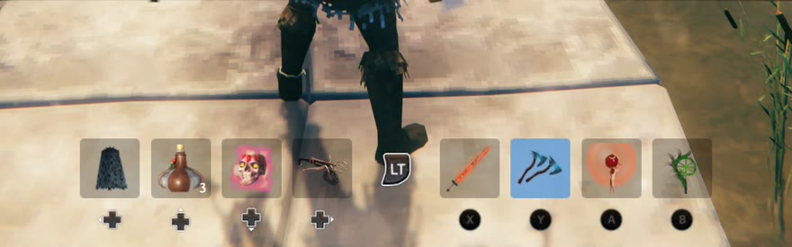
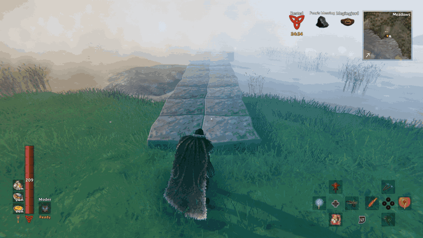

# Controller Support Plus

**Valheim on a controller, the way it should have shipped.** No new mechanics, no flashy tools: just a controller that feels right at home, in Valheim's own look and feel.

Client-side. Works on any server, and nobody else needs it. Keyboard and mouse stay exactly as they are.

## Showcase

### Controller Hotbar

Eight items on your HUD: four on the D-pad, four more with LT and the face buttons.

### Three hotbar layouts

Cross, Compact cross or Row. All three hold the same eight items, so pick the shape that suits you.

### Assigning items to the hotbar

Drag an item onto your bag's top row. The button shown in the slot's corner is the one that uses it, like 1 to 8 on keyboard.

### UI navigation and inventory management

Move the left stick and the Controller Cursor appears in your bag, chests, the build menu and pickers. A button guide under the bag shows what each button does.

| Shortcut | Does |
| --- | --- |
| RT | Sends the item to the open chest, or back to your bag |
| LT + RT | Moves a stack across and leaves one behind |
| LT + A | Takes a single item off a stack |
| Y | Tap to fill your stacks from the chest, hold to take all |
| Hold left stick | Sorts by kind. Your hotbar row and equipped gear stay put |
| X on a mannequin, item stand, item frame or boss altar | Opens it like a chest |

### LT shortcuts

Hold LT and the D-pad opens your consumables or emotes, sits you down, or takes out the hammer.

### First-launch setup

The first time you load into a world with your controller, a Begin Setup prompt appears. Press Y and pick a hotbar layout and a HUD layout. Each choice shows live on your HUD.

### Optional styles for vanilla HUD elements

Buffs and debuffs, the pickup feed and equip progress can each stay vanilla or take the mod's style. See Configuration below.

## Configuration

Open the pause menu and press **Select**, or the **Controller Support Plus** button above the menu. Switch tabs with LB and RB. Changes show on your HUD as you make them, and **Rerun setup** brings back the first-launch setup. You can also turn on **LT + Select** to open the settings straight from play. The same options are in your mod manager.

| Setting | Options |
| --- | --- |
| HUD preset | Vanilla, Bottom HUD, Action RPG |
| Hotbar layout | Cross, Compact cross, Row |
| LT + D-pad function | Function shortcuts, Item shortcuts |
| Buffs and debuffs | Vanilla, Detailed, Slim |
| Pickup notifications | Modern, Vanilla |
| Equip progress | Radial ring around the crosshair, Vanilla bar |
| Show button hints | On, Off |
| Keep HUD layout while using keyboard and mouse | On, Off |

### Controller layout

The mod adds its own controller layout, called **PRO** in the game's controller settings. It's on as soon as you install the mod. The LT quick slots (hotbar 5 to 8), the LT + D-pad shortcuts and the buttons below need it.

| Button | Does |
| --- | --- |
| B | Dodge (hold: sneak) |
| LB + RB | Forsaken power |
| Right stick click | Sheathe / draw |
| Hold LT | Quick slots (hotbar 5 to 8) |

You can switch back to one of the game's own layouts anytime in its controller settings.

## Known issues

None known yet. <!-- TODO Rob: list any known issues, and where to report bugs. -->

## Credits

Made by RobVilladiego.
